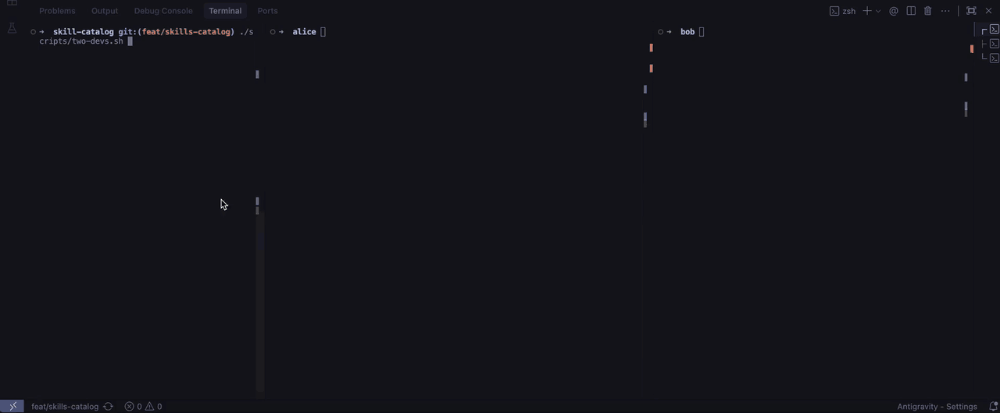
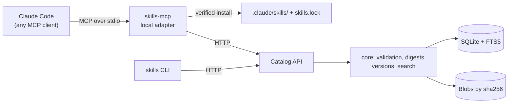

# Skills Catalog

[](https://github.com/jpbaterabsb/skills-catalog/actions/workflows/ci.yml)

**Author:** Joao Paulo Oliveira Santos

A shared, versioned catalog of [Agent Skills](https://agentskills.io/specification): developers
publish a skill once and anyone's AI assistant can find, read and install it over MCP.
What was published is byte for byte what gets installed, and every project can tell whether its
copy is still current (`skills.lock` + `check_updates`).

**Why it matters for agent memory.** A skill is an agent's *procedural memory*: how this team does
a task. Copied by hand, every developer's agent ends up with its own drifting version. The catalog
treats that memory with the three properties it needs, and each one is measured, not just claimed:

| Memory property | Mechanism | Evidence |
|---|---|---|
| **Shared**: one source of truth | Immutable versions in one catalog; publish from any session | Two-session demo; concurrent-publish test |
| **Recallable** on demand, without preloading | Search over name and description; body only on request; files straight to disk | Discovery eval: hit@1 100% with key terms; ~240 tokens for 5 results ([Evidence](#evidence)) |
| **Consistent** over time | Content digests, verified installs, `skills.lock`, drift detection | Byte-identical installs; `outdated` / `locally modified` states in E2E |

The reasoning behind it, including which memory problems this does *not* solve, is in
[DESIGN.md §1 and §15](DESIGN.md).

## Reviewer guide

| If you have | Do this | You will see |
|---|---|---|
| **2 minutes** | `uv sync && uv run pytest` | 193 tests: core, HTTP API, CLI, MCP adapter, real processes over stdio, the two-developer setup, deterministic evals |
| **1 minute**, nothing installed | [Watch the demo](#try-it-two-developers-two-claude-code-sessions) (animated, 5× speed; [full video](docs/media/two-devs-demo.mp4)) | Two real Claude Code sessions: publish, discover by need, verified install, update, drift, not found |
| **10 minutes** and Claude Code | [Two developers, two Claude Code sessions](#try-it-two-developers-two-claude-code-sessions) | Alice publishes a skill; Bob finds it by describing a need, installs it (digest verified) and uses it; drift and updates detected |
| **5 minutes** and a Claude API key | [Agentic eval](#evidence) (`uv run --group eval python -m tests.eval.agentic`) | A real agent over the MCP tools, graded by code and by a calibrated LLM judge; about $0.35 |
| Only reading time | [Architecture diagrams](docs/architecture.md), [test evidence](docs/evidence/README.md), [design](DESIGN.md) | How it works, what was measured, and why each decision was made |

Requires Python 3.11+ and [uv](https://docs.astral.sh/uv/); the Claude Code demo also needs
[Claude Code](https://code.claude.com). Nothing needs Docker or a cloud account.

## Try it: two developers, two Claude Code sessions

**Watch it first:** the whole flow below, recorded in two real Claude Code sessions (Alice in the
middle pane, Bob on the right). The animation plays at 5× speed; the full 4-minute recording is
[two-devs-demo.mp4](docs/media/two-devs-demo.mp4) (download, 5.9 MB).



<details>
<summary>Chapters (timestamps in the full video)</summary>

| Time | What happens |
|---|---|
| 0:00 | `./scripts/two-devs.sh` starts the catalog; Claude Code opens in Alice's and Bob's folders (Claude Haiku 5.5) |
| 0:30 | **Alice** publishes `incident-postmortem` → v1, digest shown, no validation errors |
| 0:55 | **Bob** asks for help with a postmortem without naming any skill; `search_skills` finds it |
| 1:10 | Bob reads it (`get_skill`): instructions and file list, no file contents |
| 1:30 | Bob installs it: `digest verified`, files in `.claude/skills/`, recorded in `skills.lock` |
| 1:45 | Bob uses it to draft a real postmortem with the team's template |
| 2:00 | **Alice** adds a section to the template and republishes → v2 |
| 2:20 | Bob: *"Are my installed skills up to date?"* → `outdated`; version history by Alice |
| 2:55 | Bob edits his installed copy by hand (silent drift) |
| 3:10 | Upgrade refused: `locally modified`; the assistant asks before forcing |
| 3:25 | Bob confirms; forced upgrade to v2; `up to date` |
| 3:40 | Unknown skill → clear "not found"; Kubernetes need → "nothing matched" |

</details>

Requires [uv](https://docs.astral.sh/uv/) and [Claude Code](https://code.claude.com) (`claude`).

```bash
./scripts/two-devs.sh                        # starts the catalog, creates ~/skills-catalog-demo/{alice,bob}
```

Then open one Claude Code session per developer:

```bash
cd ~/skills-catalog-demo/alice && claude     # Terminal 1: Alice
cd ~/skills-catalog-demo/bob && claude       # Terminal 2: Bob
```

| Who | Ask Claude | What happens |
|---|---|---|
| Alice | "Publish the skill in ./incident-postmortem to the team catalog." | `publish_skill` → `Published incident-postmortem v1` |
| Bob | "We just had a production outage. Is there a skill in our catalog that can help me write the postmortem?" | `search_skills` finds `incident-postmortem (v1)` |
| Bob | "Install it." then "Use it to draft the postmortem for: …" | `install_skill` writes `.claude/skills/incident-postmortem/` (digest verified) + `skills.lock`; Claude follows the skill |
| Alice | "Add a Customer communication section to the template and publish again." | `Published incident-postmortem v2` |
| Bob | "Are my installed skills up to date?" | `check_updates` → `outdated (v1 → v2)` |

Each folder has its own `.mcp.json` running this repo's MCP adapter as that developer; both talk
to the same catalog. The full script, including local-drift detection and "not found" cases, is
in **[docs/demo.md](docs/demo.md)**. `./scripts/two-devs.sh --reset` starts over.

**Verified with a real assistant:** this walkthrough was tested manually end to end in Claude Code
using the Claude Haiku 5.5 model (`claude-haiku-5-5`): two sessions, one publishing and one
discovering, installing and using the skill. The same flow also runs automatically in the
end-to-end tests (see below).

## Without an assistant

```bash
uv sync
uv run skills-catalog-api                    # catalog on http://127.0.0.1:8765
uv run skills publish examples/release-note-draft
uv run skills search release notes
uv run skills history release-note-draft
```

Opening this repository itself in Claude Code also works: its `.mcp.json` registers the same
server for the repo folder.

## Tests

```bash
uv run pytest                                # unit + end-to-end (real API + MCP over stdio)
uv run ruff check . && uv run ruff format --check .
```

The end-to-end tests include the two-developer demo itself: `tests/e2e/test_two_devs.py` runs
`scripts/two-devs.sh` and launches each generated `.mcp.json` the way Claude Code does.

## Evidence

Every run below, with the case-by-case table of what the agent searched and how the judge graded
it, is in **[docs/evidence](docs/evidence/README.md)** (raw JSONL traces included).

Two evals back the memory claims. They run with the test suite (as regression guards) and
`uv run python -m tests.eval.report` prints the tables below.

**Is the memory recallable?** A 12-skill catalog with deliberately overlapping skills (release
notes vs. commit messages vs. PR descriptions; postmortem vs. on-call handoff vs. error triage) and
22 developer needs, 3 of which have no right answer
([tests/eval/cases.py](tests/eval/cases.py)):

| Search input | hit@1 | hit@3 | MRR | no-match correct |
|---|---|---|---|---|
| Key terms (what `search_skills` asks the model to send) | 100% | 100% | 1.00 | 100% |
| Developer's sentence, verbatim (lower bound) | 89% | 95% | 0.92 | 67% |

The verbatim run is the worst case for a model that does not reformulate. Its misses are the known
limits of lexical search: "Document why we chose Kafka over SQS" shares no word with "Architecture
Decision Record", and "PDF invoices for our customers" overlaps with `customer-bug-report`. This
eval also found a bug: before function words were filtered, verbatim no-match accuracy was 0%,
because "the" or "our" matched every skill.

**What does recall cost in context?** Real MCP tool outputs, tokens estimated as characters / 4:

| What enters the model's context | Tokens |
|---|---|
| `search_skills`, 5 results (one line each) | ~240 |
| `get_skill incident-postmortem` (SKILL.md + file list) | ~485 |
| `install_skill incident-postmortem` (one confirmation line) | ~60 |
| Supporting files, written to disk and never put in context | 172 |
| `incident-postmortem` with every file inlined | 596 |

Discovery cost depends on the number of results, not on the size of the catalog: preloading
100 skills like the examples would take about 50,000 tokens, while a search stays at five lines.

**Does a real agent find the right skill?** The two evals above fix the search query. The agentic
eval does not: each need goes to Claude Haiku 5.5 in a tool loop over the real MCP server, and every
step (tool, arguments, output) is recorded. Grading has two layers: code-graded checks on the trace
(did it search, did the first search rank the right skill first) and an **LLM judge** (Claude
Opus 5.5, structured JSON output) that grades the final answer against a rubric: right skill or a
clear "none fits", and no invented skills or capabilities. The judge is calibrated first against
seven hand-labelled answers built to catch a lenient judge (a related but wrong skill, a lexical
false positive, an invented name, a padded capability).

It calls the Claude API, so it is opt-in and needs your key:

```bash
cp .env.example .env                          # then set ANTHROPIC_API_KEY in .env
uv run --group eval python -m tests.eval.agentic
```

It prints judge agreement, search rate, retrieval accuracy, judge-graded correctness,
hallucination rate and the estimated cost of the run (well under a dollar), and writes the
step-by-step trace of every case to `.eval-runs/*.jsonl`. As a test with pass thresholds:
`SKILLS_EVAL_AGENTIC=1 uv run --group eval pytest tests/eval/test_agentic_live.py`. Without a
key, its harness is still covered by offline tests that script the model's responses.

| First live run, before any fix (22 dev needs) | Value |
|---|---|
| Agent called `search_skills` | 77% |
| First search ranked the right skill first | 77% (100% of the needs where it searched) |
| Final answer correct (LLM judge) | 73% |
| Final answer hallucinated a skill or capability (LLM judge) | 0% |
| Judge agreement with hand labels | 86% (6 of 7; the disagreement was a wrong label) |
| Cost of the run | $0.24 |

What it found, and what changed: retrieval was never the problem (every search the agent made
ranked the right skill first); routing was. For 5 needs the agent never consulted the catalog and
answered from general knowledge, because the tool description only said to search when asked
whether a skill exists. The trigger now says to search before any task the team may have a
standard way of doing ([server.py](src/skills_catalog/adapter/server.py)). The run also exposed
two flaws in the eval itself, both fixed: a metric that credited "no match" without a search, and
a synthetic skill body so thin that the agent rightly called it a stub. Six held-out needs,
written before the description change and never used to tune it, now show whether the fix
generalizes.

| Second live run, after the fixes | dev (22) | holdout (6) |
|---|---|---|
| Agent called `search_skills` | 100% | 100% |
| First search ranked the right skill first | 100% | 100% |
| Final answer correct (LLM judge) | 100% | 100% |
| Final answer hallucinated (LLM judge) | 0% | 0% |
| Tool calls per need (mean) | 2.6 | 3.0 |

The held-out needs improved as much as the dev needs, so the description change generalizes
rather than memorizing the failures. The price is more tool calls per need (1.5 → 2.7, about
$0.012 per need), the trade-off the new trigger accepts. Caveats: one run of a sampled model on
28 needs, so a single case moves a metric by 4 to 17 points; and a perfect score means this set no
longer discriminates, so the next step is harder cases, not a higher score.

---

## How it works



Sequence diagrams for publish and install, the drift state machine, the data model and the
verification pipeline: **[docs/architecture.md](docs/architecture.md)**.

- **core**: validation (Agent Skills format, safe paths, size limits), deterministic digests,
  immutable integer versions, SQLite with FTS5 search, content-addressed blob store.
- **API** (FastAPI): the shared catalog. `POST /skills`, `GET /skills?q=`, `GET /skills/{name}`,
  `GET /skills/{name}/versions`, `GET /blobs/{sha256}`, `GET /health`.
- **adapter**: MCP tools `search_skills`, `get_skill`, `install_skill`, `list_versions`,
  `check_updates`, `publish_skill`. Install verifies every hash before an atomic rename, so the
  model decides *what* to install but never handles the bytes.
- **CLI**: `skills publish | search | get | history`.

Design rationale, decisions and threat model: [DESIGN.md](DESIGN.md). Decisions made while
building it: [docs/NOTES.md](docs/NOTES.md).

### Configuration

| Variable | Default | Used by |
|---|---|---|
| `SKILLS_CATALOG_URL` | `http://127.0.0.1:8765` | adapter, CLI (the API binds to its host and port) |
| `SKILLS_CATALOG_DATA` | `./.catalog-data` | API: `catalog.db` and `blobs/` |
| `SKILLS_AUTHOR` | `git config user.name`, else `$USER` | publish |
| `SKILLS_PROJECT_ROOT` | current directory | adapter: install target and `skills.lock` |

### Project layout

```
src/skills_catalog/
  core/      errors, models, validation, digest, store, search, service
  api/       FastAPI app
  adapter/   HTTP client, installer (+ update checks), lockfile, MCP server
  cli.py
examples/    release-note-draft, incident-postmortem skills
tests/       unit/ (core, API, CLI, adapter, MCP in memory), e2e/ (real processes),
             eval/ (discovery, context-budget and agentic LLM-judge evals)
scripts/     two-devs.sh (Claude Code demo), demo.sh (CLI demo)
docs/        demo.md, NOTES.md
```

### Known limitations

- No authentication or ownership: anyone who can reach the catalog can publish a new version of
  any skill (by design for the MVP; first item for Phase 2).
- One global namespace; names are first come, first served.
- Lexical search (FTS5 with stemming): synonyms only match if the assistant reformulates them.
- SQLite allows one writer at a time; fine for publishing, not for a large organization.
- Orphaned blobs from failed publishes are never garbage-collected.
- Upgrading an installed skill swaps directories with two renames; a crash between them leaves
  the previous version in a hidden backup directory next to it (see docs/NOTES.md).
- In this repository `skills.lock` and `.claude/skills/` are git-ignored because the demo installs
  into the repo itself; in a consumer project you would commit `skills.lock`.
