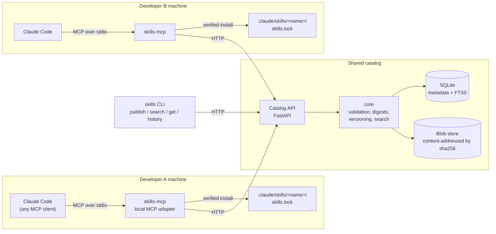
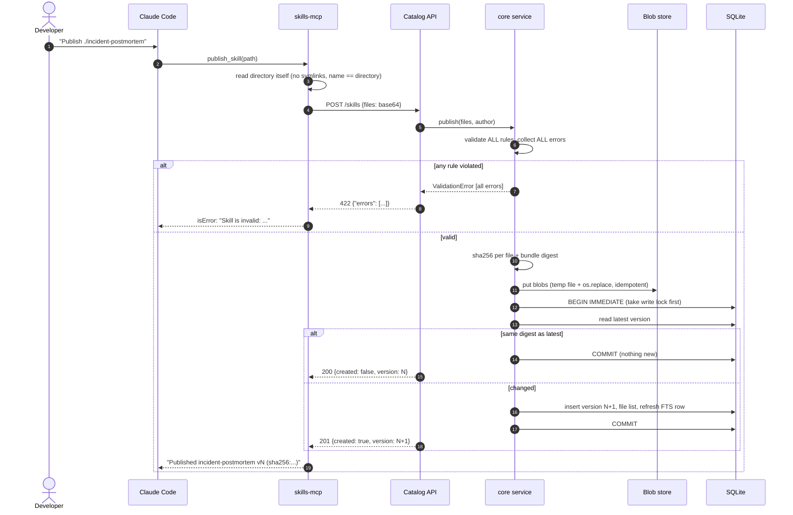
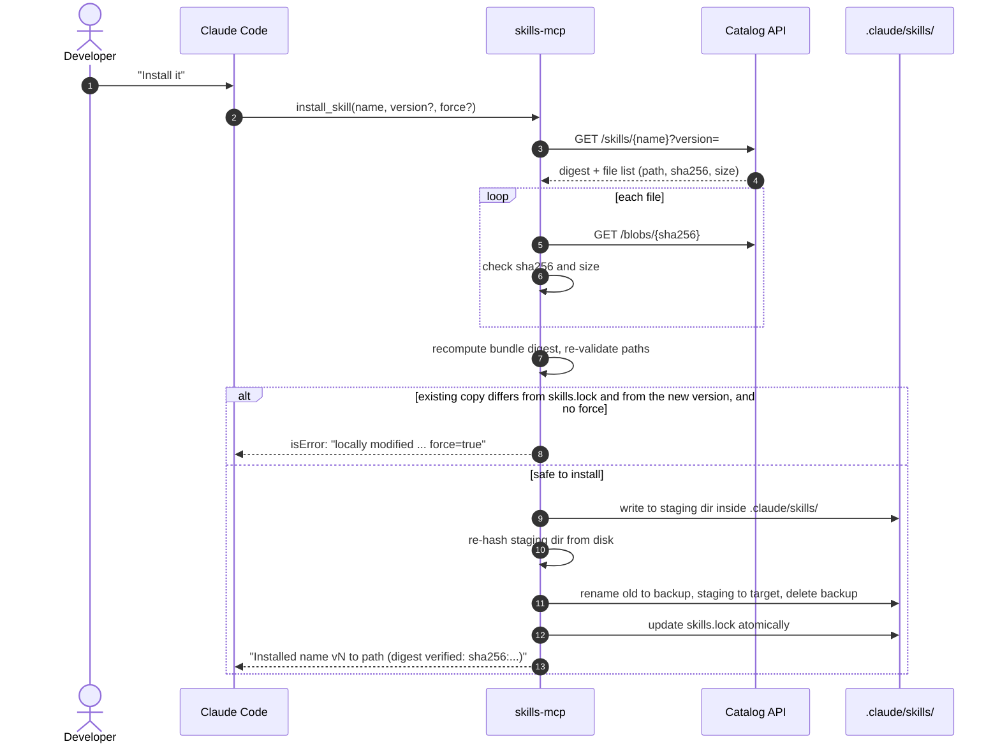
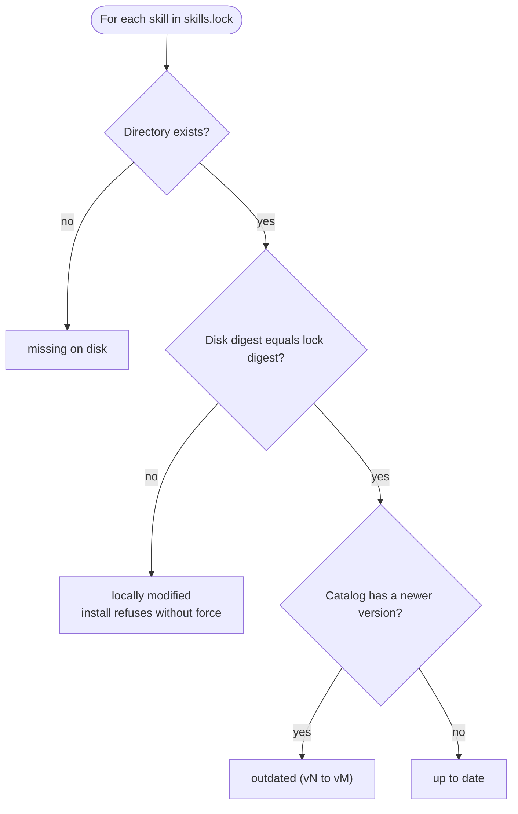
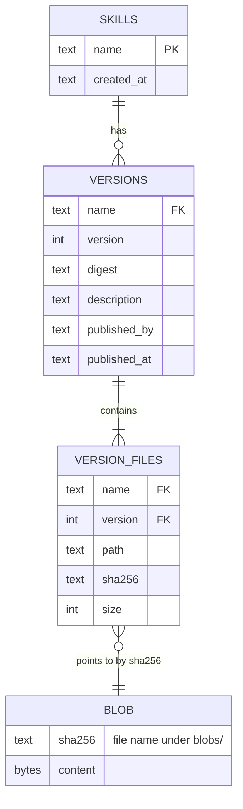
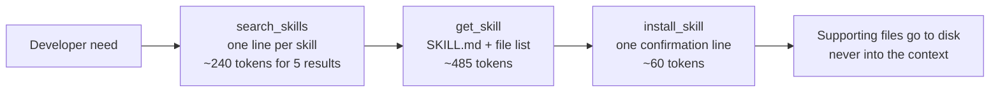
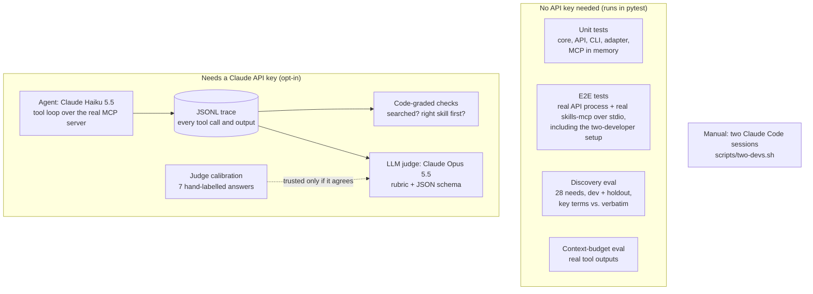

# Architecture

How the pieces fit, how bytes move, and where each guarantee is enforced. Rationale and
trade-offs are in [DESIGN.md](../DESIGN.md); this page is the visual companion.

## 1. Components

Each developer runs a small local MCP adapter next to their assistant; all adapters talk to one
shared catalog over HTTP. The model decides *what* to search, read or install; code moves the bytes.

| Component | Code | Responsibility |
|---|---|---|
| core | `src/skills_catalog/core/` | Pure domain: validation, digests, immutable versions, search. No HTTP, no MCP. |
| Catalog API | `src/skills_catalog/api/app.py` | Thin HTTP layer; domain errors mapped to status codes in one place. |
| MCP adapter | `src/skills_catalog/adapter/` | Six tools for the model; HTTP client, verified installer, lockfile, update checks. |
| CLI | `src/skills_catalog/cli.py` | The same operations for humans and scripts. |

## 2. Publish: validate everything, then commit one version atomically

Guarantees: a rejected publish writes nothing; a version becomes visible only at `COMMIT`;
two concurrent publishers get distinct versions (`BEGIN IMMEDIATE` + `PRIMARY KEY (name, version)`);
republishing identical content does not grow the history.

## 3. Install: verify every byte before it becomes visible

Any failure deletes the staging directory and leaves the existing install and `skills.lock`
untouched. The model never sees or retypes file contents.

## 4. Consistency: three digests, four states

`check_updates` compares the files on disk, the lockfile and the catalog's latest version.

"Locally modified" is the PRD's silent drift, made visible.

## 5. Data model

`skills_fts(name, description)` is an FTS5 index holding the latest version of each skill.
Versions are immutable; "latest" is simply the highest version number.

## 6. Context budget: progressive disclosure

Discovery cost depends on the number of results, not on the size of the catalog. Measured in
`tests/eval/context_budget.py`.

## 7. How it is verified

Results and traces: [docs/evidence](evidence/README.md).
